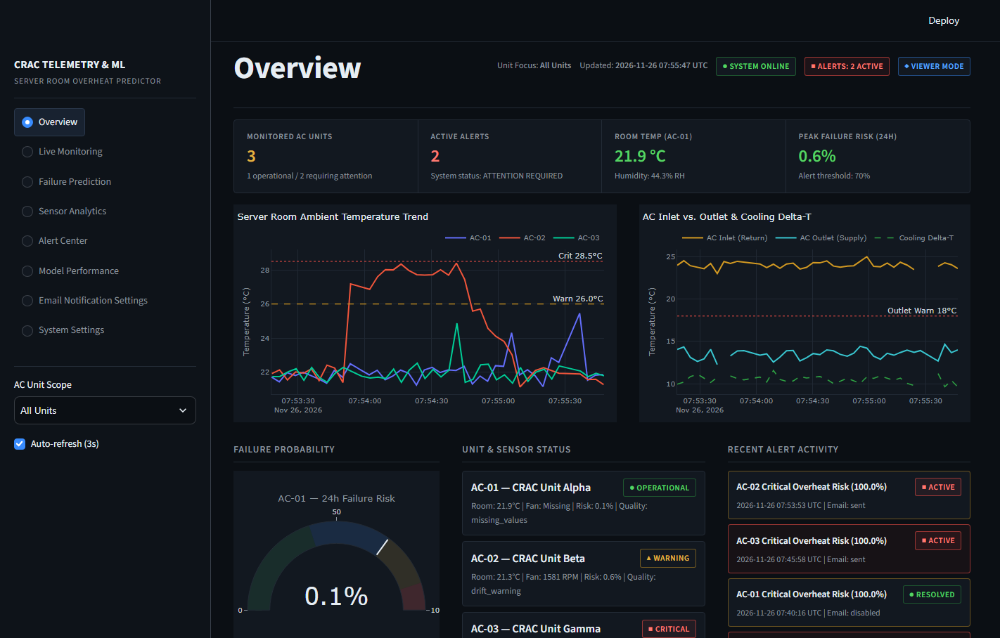
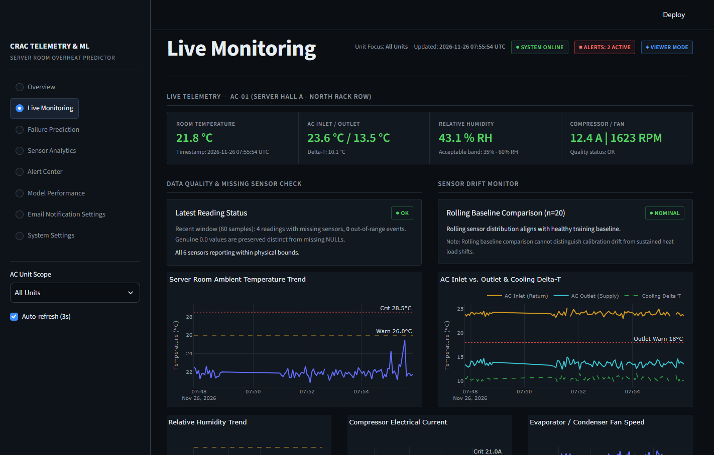
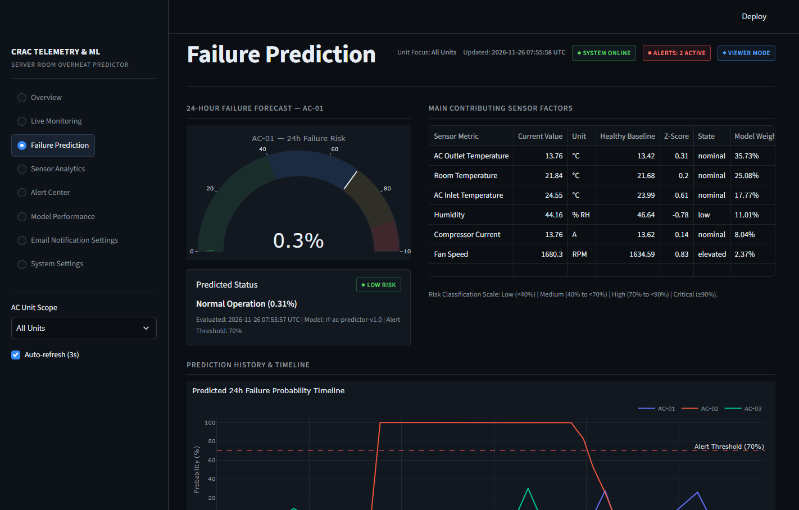
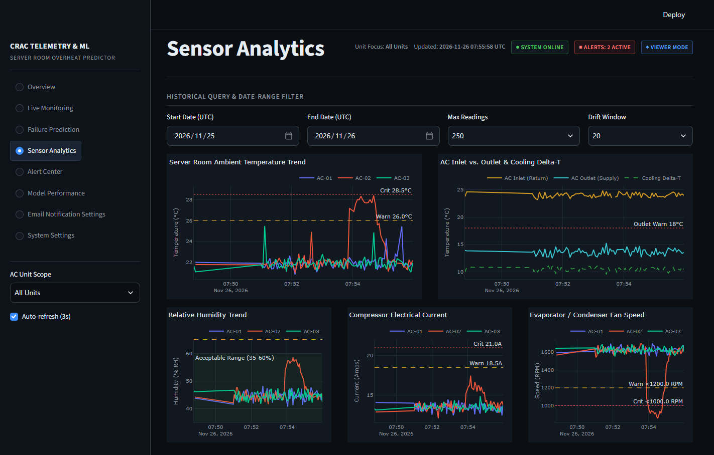
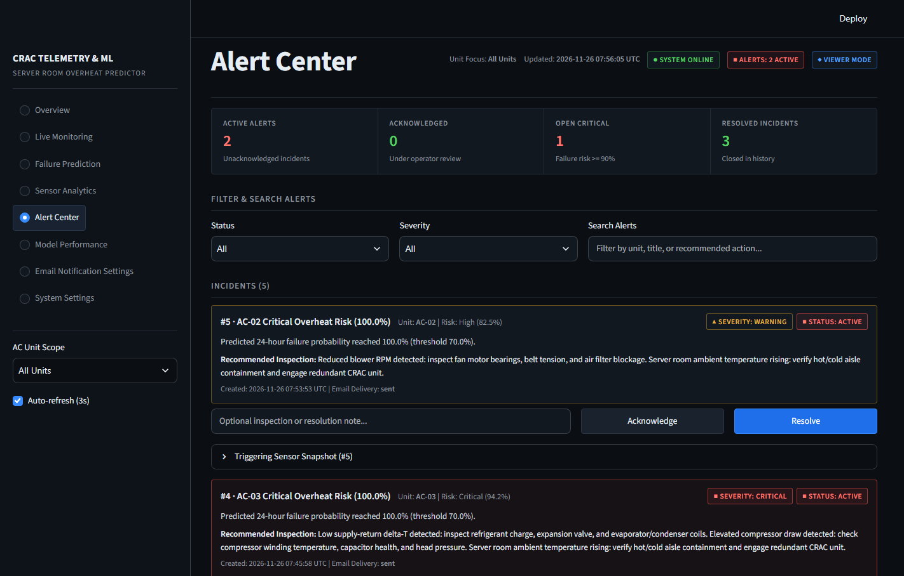
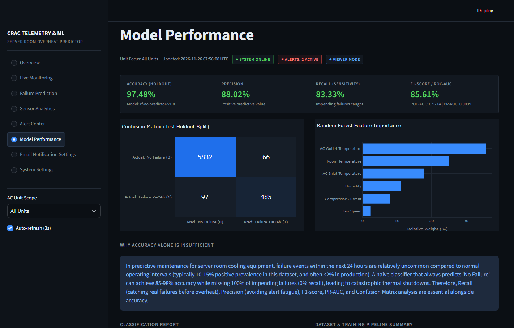
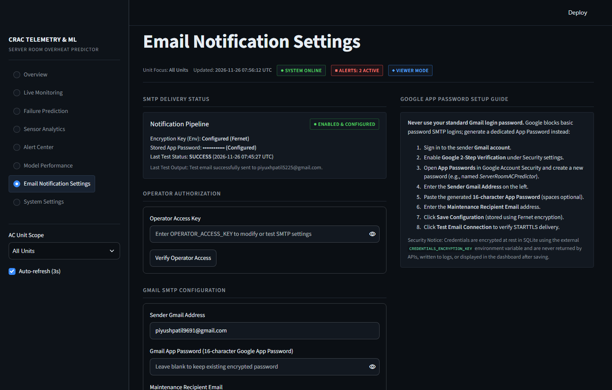
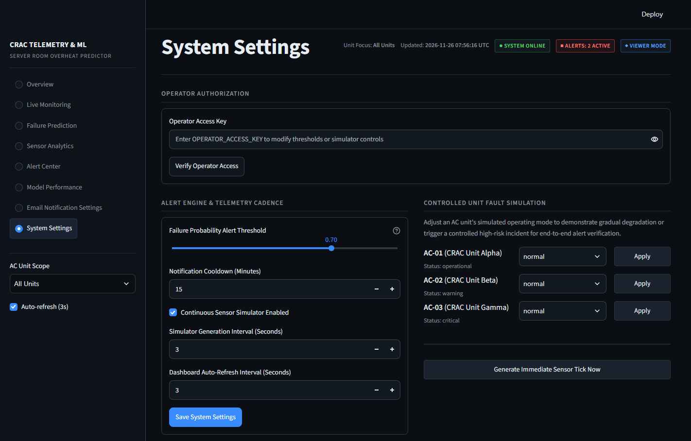
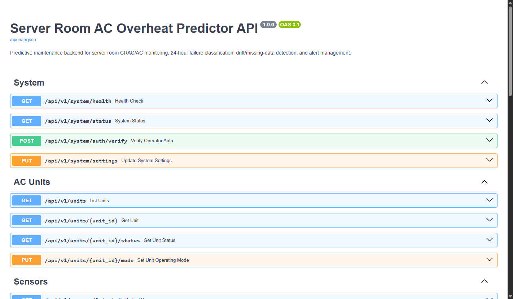

# Server Room AC Overheat Predictor — Technical Project Report

## 1. Executive Summary

The **Server Room AC Overheat Predictor** is an end-to-end predictive maintenance system built for monitoring Server Room Computer Room Air Conditioning (CRAC) units (`AC-01`, `AC-02`, `AC-03`). Rather than waiting for ambient room temperatures to breach critical hardware limits, the system continuously evaluates six correlated physical sensor streams and predicts the probability of equipment failure within the next **24 hours** using a trained Random Forest Classifier.

When predicted failure risk crosses the configurable threshold (default **70%**), an independent background alert engine in FastAPI creates a deduplicated incident in SQLite and dispatches a **Gmail SMTP (STARTTLS)** maintenance email with recommended inspection steps.

---

## 2. System Architecture & Services

The platform is containerized into three cooperating Docker Compose services backed by a shared SQLite WAL database volume (`sqlite_data`):

1. **Sensor Simulator (`simulator`)**: Continuously generates realistic, physically correlated sensor readings (`room_temp`, `ac_outlet_temp`, `ac_inlet_temp`, `humidity`, `compressor_current`, `fan_speed`) across normal, degrading, and critical unit states.
2. **FastAPI Backend & Background Alert Engine (`backend`)**: Validates incoming data quality, runs rolling baseline drift diagnostics, scores readings with the persisted Joblib ML pipeline, evaluates alert rules/cooldowns independently of any browser session, and serves REST endpoints with Swagger UI (`/docs`).
3. **Streamlit Monitoring Dashboard (`dashboard`)**: Provides an industrial dark-theme interface across eight functional views with automatic 3-second fragment refreshes (`@st.fragment`), interactive Plotly charts, alert acknowledgement/resolution, and encrypted Gmail SMTP configuration.

---

## 3. Machine Learning Pipeline & Observed Evaluation

### Synthetic Historical Dataset (`ml/generate_dataset.py`)
- **Size & Cadence**: `25,920` rows sampled at 15-minute intervals over 90 days across three CRAC units.
- **Fault Physics**: Models daily server heat cycles, non-failing transient workload spikes, and three gradual fault trajectories (`refrigerant_leak`, `fan_wear`, `compressor_overload`).
- **24-Hour Lookahead Labeling**: `failure_within_24h = 1` if a simulated failure event occurs in the future window `(t, t + 24h]`, preventing target leakage from single-row features.
- **Missing Values**: Injects ~2.5% missing readings (`3,923` missing values total) handled via `SimpleImputer(strategy="median")` inside the Scikit-learn `Pipeline`.

### Evaluation Results (`ml/models/model_evaluation.json`)
Evaluated on a **chronological 75% / 25% holdout split** (`19,440` train / `6,480` test rows) to prevent temporal data leakage:

| Metric | Observed Score | Notes |
|---|---|---|
| **Positive Class Prevalence** | `8.98%` | Class imbalance reflects infrequent failures |
| **Accuracy** | `97.48%` (`0.9748`) | Overall correct predictions on holdout split |
| **Precision** | `88.02%` (`0.8802`) | Low false-alarm rate |
| **Recall (Sensitivity)** | `83.33%` (`0.8333`) | Impending 24h failures successfully caught |
| **F1-Score** | `85.61%` (`0.8561`) | Balanced precision/recall performance |
| **ROC-AUC / PR-AUC** | `0.9714` / `0.9099` | Strong probability ranking across thresholds |
| **Confusion Matrix (`n = 6,480`)** | `TN=5832`, `FP=66`, `FN=97`, `TP=485` | Verified from actual holdout evaluation |

*Why accuracy alone is insufficient:* In predictive maintenance, failure cases are the minority. A model predicting "No Failure" for every reading would exceed 91% accuracy while missing 100% of thermal failures (`0%` recall). Evaluating Recall, Precision, F1-score, PR-AUC, and the Confusion Matrix is mandatory.

---

## 4. Dashboard & API Screenshots

### 4.1 Overview
Fleet KPI summary strip (monitored units, active alerts, live room temperature, peak 24h failure risk), room temperature and inlet/outlet cooling Delta-T trends, failure probability gauge, unit status summary, and recent alert activity.

### 4.2 Live Monitoring
Real-time telemetry for all six sensors, data-quality validation (preserving genuine `0.0` readings distinct from missing `NULL`s), rolling baseline drift monitor, and individual live sensor charts.

### 4.3 Failure Prediction
24-hour failure risk gauge, risk tier classification (`Low`, `Medium`, `High`, `Critical`), ranked contributing sensor factors compared against healthy baselines, and prediction probability timeline.

### 4.4 Sensor Analytics
Date-range filtered historical sensor trends, AC inlet vs. outlet cooling Delta-T analysis, per-sensor drift diagnostics (`Z-Shift` and tail exceedance rates) with documented methodology limitations, and raw telemetry table.

### 4.5 Alert Center
Incident management with severity and status filters, text search, color + symbol status badges, recommended maintenance inspection actions, email delivery status tracking, triggering sensor snapshots, and Acknowledge / Resolve workflows.

### 4.6 Model Performance
Real Scikit-learn holdout evaluation metrics, Confusion Matrix heatmap, Random Forest feature importance ranking, per-class classification report, dataset summary, and imbalance explanation.

### 4.7 Email Notification Settings
Operator-authorized Gmail SMTP configuration using Google App Passwords encrypted with `Fernet` (`CREDENTIALS_ENCRYPTION_KEY` stored externally in `.env`), masked credential state, STARTTLS support, enable/disable toggle, and live test email verification.

### 4.8 System Settings
Operator-authorized configuration for alert threshold, cooldown window, simulator cadence, dashboard auto-refresh interval, and per-unit fault simulation modes (`normal`, `degrading`, `critical`) for controlled incident verification.

### 4.9 FastAPI Backend Swagger Documentation (`/docs`)
Interactive OpenAPI specification exposing health, system settings, AC unit telemetry, sensor ingestion/drift/quality, predictions, alert lifecycle, and safe email configuration endpoints.

---

## 5. Security & Verification Summary

- **Credential Protection**: Gmail App Passwords are encrypted with `cryptography.fernet.Fernet` at rest in SQLite; `CREDENTIALS_ENCRYPTION_KEY` is read strictly from environment variables. Passwords are never returned by APIs, echoed in HTTP 422 validation errors (enforced via `SecretStr` and a custom `RequestValidationError` redaction handler), or written to logs.
- **Operator Access Control**: Privileged configuration endpoints (`PUT /api/v1/email/config`, `PATCH /api/v1/email/toggle`, `POST /api/v1/email/test`, `PUT /api/v1/system/settings`, `PUT /api/v1/units/{id}/mode`) verify `X-Operator-Key` using constant-time `hmac.compare_digest`.
- **Automated Test Suite (`python -m pytest -v`)**: **13/13 tests passing** across ML pipeline, missing vs. zero distinction, drift detection, alert deduplication/cooldown, SMTP failure handling, API security, and end-to-end restart persistence.
- **Docker Compose & Launcher Verification**: Verified multi-container startup via [setup.bat](setup.bat) and `docker compose up -d --build`, live continuous ingestion, controlled critical alert creation, email dispatch, and SQLite persistence across `docker compose restart`.
